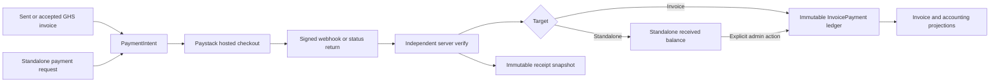
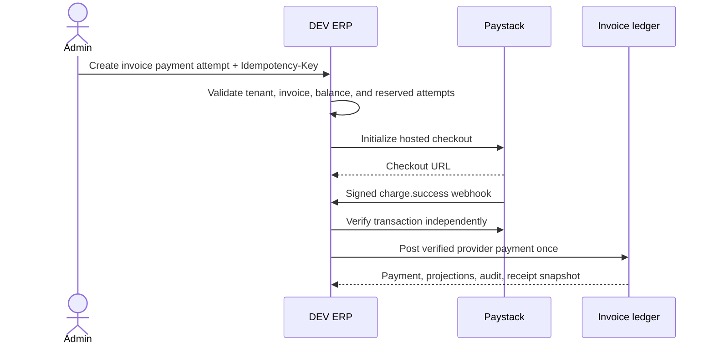
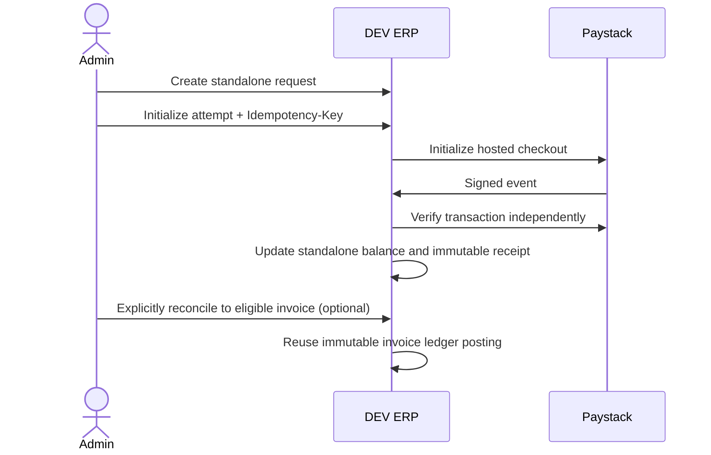
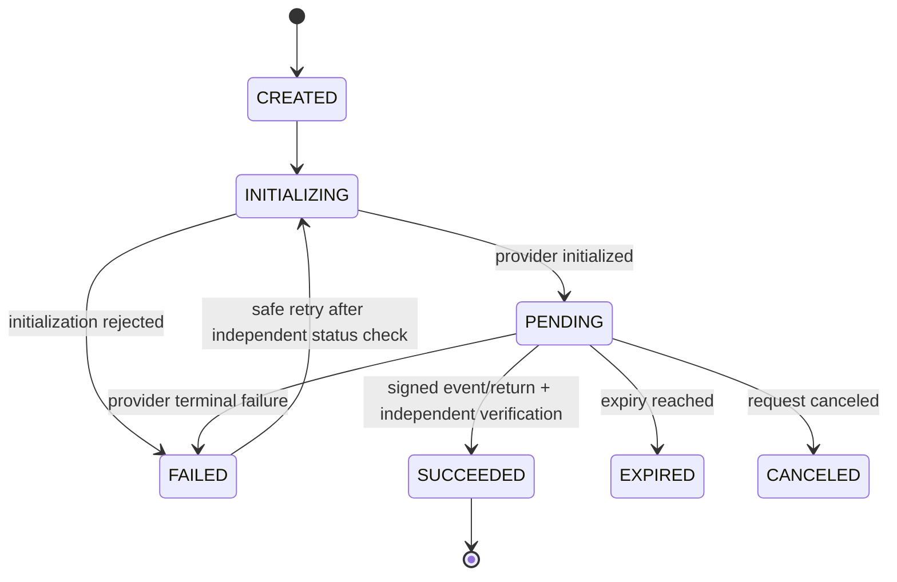
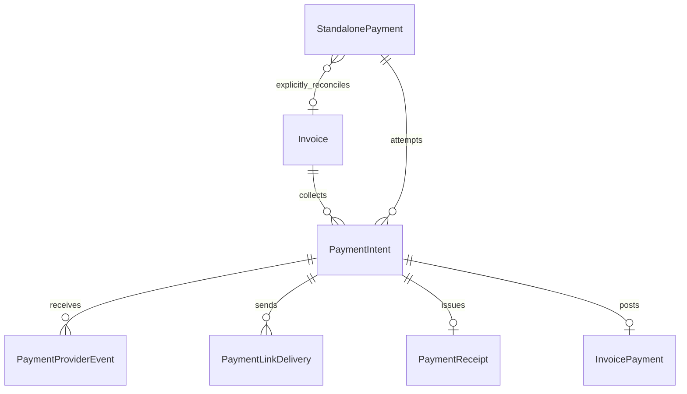

# DEV ERP Paystack Payment Integration

## Status

The Paystack implementation is complete in code but remains **disabled and NOT READY for production**. No production migration, keys, webhook, payment, email, or deployment was changed.

Release requires the additive migration and concurrency harness to pass on an approved disposable PostgreSQL database, Paystack test-mode end-to-end evidence, an explicit live-mode review, and completion or acceptance of the dependency-audit gates.

## Architecture and boundaries

Paystack is a collection provider, not a second invoice, accounting, or proposal system.



- Existing invoices, the Phase 6 immutable ledger, and Accounting remain authoritative for issued financial records.
- Standalone collections do not create invoices or accounting entries automatically. An administrator must explicitly reconcile a settled request to an eligible same-tenant invoice.
- Proposal acceptance remains separate. No proposal approval automatically creates a payment.
- Rent and existing manual payment workflows are unchanged.

## Persistence

Additive migration `20261022130000_add_paystack_payment_collection` follows the proposal email migration. It adds `StandalonePayment`, `PaymentIntent`, `PaymentLinkDelivery`, `PaymentProviderEvent`, and `PaymentReceipt`, plus optional relations to existing invoices, invoice payments, organizations, and users. It does not rewrite legacy invoices, quotations, paid amounts, ledger entries, accounting entries, proposals, rent payments, or public links. `customerReference` is the compatibility link for standalone requests because DEV ERP does not currently have an authoritative customer-master model.

Provider amounts use integer pesewas. Invoice postings reuse the existing decimal ledger contract. Database constraints reject non-positive attempts and impossible standalone balances. Provider transaction IDs, references, token hashes, event fingerprints, and tenant-scoped initialization keys are unique.









## Verified settlement lifecycle

1. An authenticated administrator with Invoicing access supplies an `Idempotency-Key` and requests an invoice or standalone attempt.
2. The server verifies tenant ownership, eligible state, GHS currency, customer email, exact balance, reserved attempts, and link lifetime.
3. The server creates the reference/token and initializes provider-hosted checkout. The browser receives only the checkout URL and safe metadata.
4. `/api/webhooks/paystack` verifies HMAC-SHA512 against the exact raw request body.
5. A success event or redirect is never trusted alone. The backend independently verifies reference, amount, currency, customer, and test/live domain with Paystack.
6. Reconciliation uses a serializable transaction and row locks. Duplicate delivery cannot create a second payment, posting, standalone settlement, or receipt.
7. Invoice settlement posts through the Phase 6 immutable ledger and updates existing invoice/accounting projections transactionally. Standalone settlement updates only its received balance.
8. Receipts are generated only from immutable server-verified snapshots.

Failed/mismatched events become safe reconciliation exceptions. Secrets, provider payloads, instrument details, and raw public tokens are not logged or persisted.

## API

Authenticated Admin/Invoicing routes:

- `POST /api/invoices/:id/paystack-intents`
- `POST /api/payments/standalone`
- `POST /api/payments/standalone/:id/intents`
- `GET /api/payments/requests` and `GET /api/payments/requests/:id`
- `POST /api/payments/requests/:id/cancel`
- `POST /api/payments/requests/:id/reconcile-invoice`
- `POST /api/payments/intents/:id/retry` and `/send`
- `GET /api/payments/receipts/:id` and `POST /api/payments/receipts/:id/send`
- `GET /api/payments/reconciliation-exceptions`

Public provider/token routes:

- `POST /api/webhooks/paystack`
- `GET /api/public/payments/status/:token`
- `GET /api/public/payments/status/:token/receipt`

Authenticated writes retain cookie auth, Admin authorization, CSRF, tenant checks, and mutation idempotency. Payment-link email delivery also requires an `Idempotency-Key`; each claim is stored separately so network retries cannot send duplicate email, while an intentional resend uses a new key. Public tokens are hashed at rest. Hosted checkout means DEV ERP never receives card numbers, CVVs, MoMo PINs, or reusable authorization credentials.

## Environment setup

```dotenv
PAYSTACK_PAYMENTS_ENABLED="false"
PAYSTACK_MODE="test"
PAYSTACK_SECRET_KEY="sk_test_replace_me"
PAYSTACK_CALLBACK_URL="https://your-dev-erp-frontend.example/payment/status"
PAYSTACK_CURRENCY="GHS"
PAYMENT_EMAIL_FROM="payments@your-verified-domain.example"
```

- Start disabled and in test mode. The secret prefix must match `PAYSTACK_MODE`.
- The account secret also verifies webhooks; there is no separate invented webhook secret.
- The callback must be the trusted HTTPS frontend status page. The server adds its token.
- Configure Paystack to post to `https://<api-host>/api/webhooks/paystack`.
- Never use a `VITE_*` variable for Paystack secrets.
- The payment sender must be accepted by the existing email provider/domain. Human email continues through the central BCC policy.

## Test and release procedure

1. Create a disposable loopback PostgreSQL database whose name contains `test`, `tmp`, or `disposable`.
2. Export `DEV_ERP_TEST_DATABASE_URL`. The harness refuses production/default and non-loopback URLs.
3. Run `pnpm --filter @faako/dev-erp test:payments:postgres` and `pnpm --filter @faako/dev-erp test:paystack:postgres`.
4. Run full tests, lint, typecheck, Prisma validate/generate, production build, desktop/mobile E2E, dependency audit, and whitespace checks.
5. Deploy migrations to isolated preview before preview code.
6. In test mode verify invoice full/deposit/partial payment, duplicate webhook, mismatch/failure exceptions, standalone partial settlement, explicit invoice reconciliation, receipt download/email, expiry, and tenant isolation.
7. Review audit and reconciliation evidence, then perform a separate live-mode approval. Verify one bounded real payment across Paystack, ledger, invoice, Accounting, receipt, and email.

## Rollback

Set `PAYSTACK_PAYMENTS_ENABLED=false` first; this blocks new initialization and link delivery while configured webhook/status verification continues to reconcile attempts that may already have reached Paystack. Review unsettled attempts before rolling code back. Never delete payment, event, receipt, ledger, or audit rows. After real data exists, correct schema issues through forward migrations rather than dropping these additive tables.
