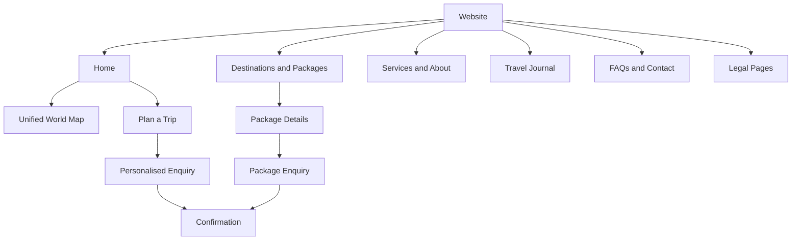
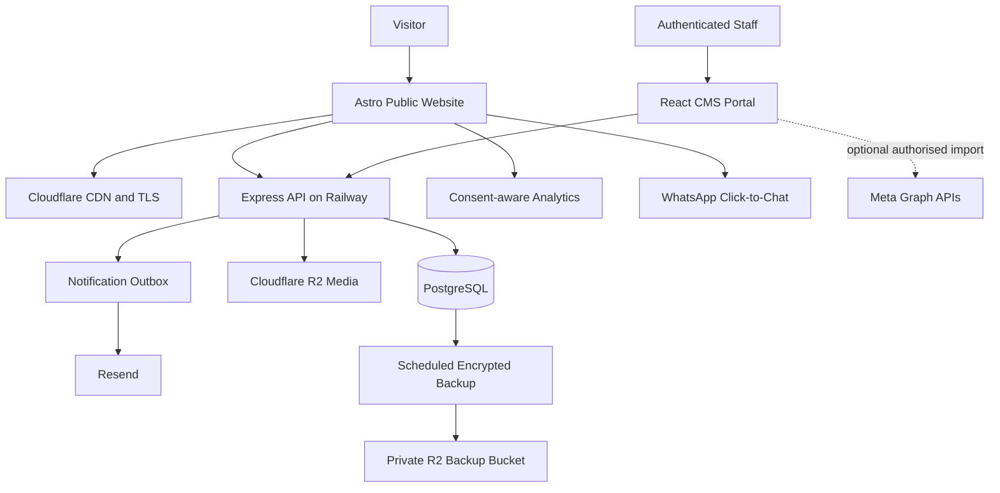
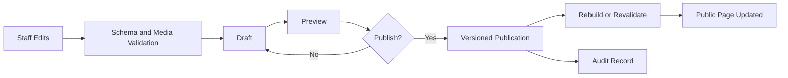
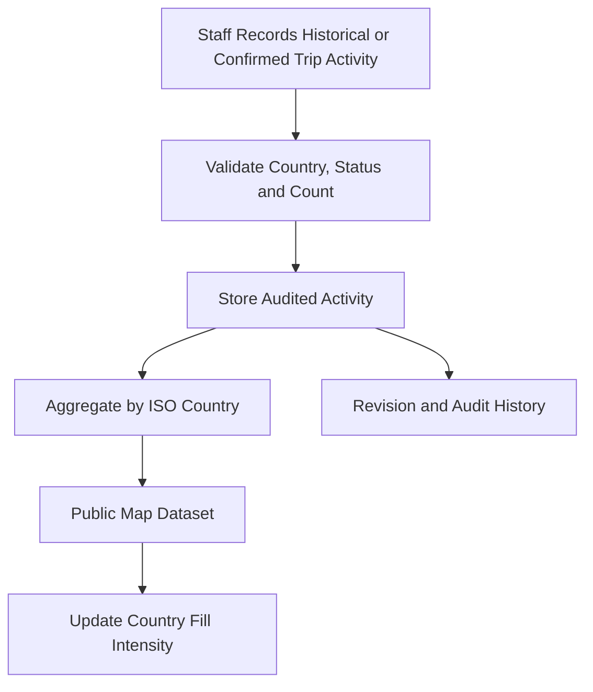
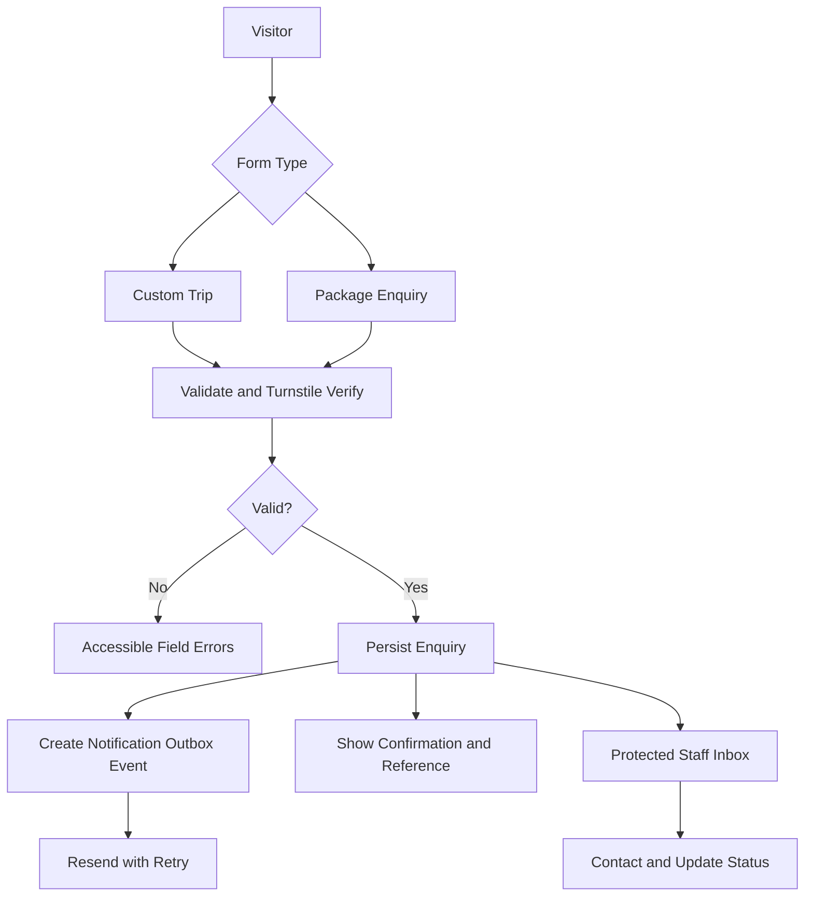
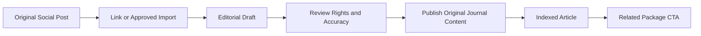
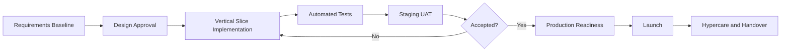

# Travel With Ease
## Solution Architecture, Product Scope & Implementation Roadmap
**Version:** 1.0 | **Date:** October 2026 | **Prepared by:** Faako  
**Status:** Proposed implementation baseline; client scope and legal terms subject to approval.

## 1. Executive summary
Build a fast, mobile-first travel agency website for a primarily Ghanaian audience. The initial release will provide packages, a personalised trip enquiry form, a package enquiry form, email notifications, WhatsApp contact, a client-editable CMS, a travel journal, and a unified world destination footprint. The solution is not a booking engine, payment platform, full CRM, or itinerary system.

The existing `faako-system` workspaces remain: `travel-with-ease-web` (Astro), `travel-with-ease-api` (Express), and `travel-with-ease-portal` (React). Reuse existing shared contracts, validation, logging and security utilities where appropriate. Preserve but defer the current estimator/currency and advanced travel features.

### Architecture decisions
| Layer | Selected approach | Rationale |
|---|---|---|
| Public website | Astro with minimal React islands | SEO, speed, low JS |
| Admin portal | React | Focused content and enquiry management |
| API | Node.js / Express | Fits existing monorepo |
| Database | PostgreSQL | Durable transactional storage |
| Public hosting | Cloudflare | CDN, TLS and edge delivery |
| API / database hosting | Railway | Existing operational familiarity |
| Media / off-site backups | Cloudflare R2 | Object storage with private access |
| Email | Resend | Transactional notifications |
| Bot protection | Cloudflare Turnstile | Public form abuse controls |

## 2. Scope and exclusions
### Launch scope
- Public pages: Home, Destinations/Packages, Services, About/Testimonials, Travel Journal, FAQs, Contact and legal pages.
- Package detail pages with indicative 'from' prices, date/tier information and clear non-binding price disclosures.
- Two independent enquiry forms: personalised trip and package-specific.
- Database-backed enquiry inbox with simple New, Contacted and Closed statuses.
- Email notification queue, delivery status and retries; WhatsApp click-to-chat.
- Structured CMS for selected text, FAQs, testimonials, packages, journal, images, metadata and contact details.
- Draft, preview, publish/unpublish, revision history and basic rollback.
- Unified world map combining completed and confirmed upcoming trips into one country intensity.
- SEO/AEO, analytics with applicable consent handling, security, backups and handover.

### Deferred / separately scoped
- Online payments, Paystack checkout, invoicing, live exchange rates and estimator.
- Automated WhatsApp messaging, full CRM, itinerary management and customer portal.
- Automated social synchronisation, AI-generated travel itineraries and advanced analytics.

## 3. Information architecture and customer journey

The homepage should follow an editorial sequence: photographic hero and clear CTA; featured packages; travel footprint; how it works; travel journal; testimonials/FAQs; final enquiry CTA. Mobile navigation and form usability are first-class requirements.

## 4. Design direction and quality bar
**Avoid a generic AI-generated aesthetic.** Do not default to gradients, glassmorphism, repeated cards, ubiquitous eyebrows/kickers, glowing borders, decorative blobs, oversized rounded corners or excessive motion. Use a disciplined grid, intentional whitespace, real travel photography, confident typography, clear hierarchy and strong editorial composition. Each section must earn its place; avoid repeating the same card grid. Keep copy concise and specific. Use the brand palette: navy `#010c33`, cream `#f4ede3`, gold `#d8b56a`, grey `#b6b1a9`, blue `#7ab8ff`, dark `#000a1f`.

React Bits may be used selectively (e.g. Split Text, Scroll Reveal, Spotlight Card or a restrained hero background), only where it improves comprehension or craft. No gratuitous animations; support reduced motion, keyboard access, touch devices and strong Core Web Vitals. Maintain Astro SSR/static discoverability rather than rendering core copy only in React.

## 5. Target architecture

The public browser can access only approved public endpoints. Staff content and enquiry operations require server-side authorization. Do not expose API secrets, private records or privileged R2 URLs to browsers. Public content publishing must trigger controlled cache invalidation/rebuild with a visible publication state and retries.

## 6. CMS and publishing workflow
Editable: selected hero copy, service descriptions, packages, FAQs, testimonials, journal articles, images, contact details, CTAs and SEO fields. Non-editable: application layout, navigation structure, security rules, validation copy and code-owned components.

The portal navigation should be Overview, Enquiries, Website Content, Packages, Travel Journal, Travel Footprint, Media Library and Settings. Single-user launch scope is sufficient; still implement secure sessions and authoritative access checks. Sanitize rich text, restrict media type/size, and prevent stored XSS.

## 7. Unified world travel footprint
**One map, no completed/upcoming switch.** Country intensity reflects `total = completed trips + confirmed upcoming trips`. Enquiries, tentative bookings and cancelled trips do not count. A multi-country trip may count once per visited destination country; define deduplication and historical import rules.

Use accurate geographic boundaries with ISO country codes. Render a responsive accessible choropleth with a subdued base, a restrained gold intensity scale, tooltips/tap details, and an accessible country list/table fallback. Use a logarithmic or quantile scale with a documented legend; no fabricated activity numbers. Display only aggregate counts, never traveller identities.

Proposed fields: activity ID, country ISO code, count, completed/confirmed-upcoming status, period, source, publication flag, editor and timestamps. Expose aggregate totals only. Future booking integration can replace manual entry without changing the public contract.

## 8. Enquiries and notifications

Collect only name, email/phone, destination/package, preferred dates, traveller count, budget range where relevant, preferences and optional notes. Store source, timestamps and consent/notice evidence. Do not collect passport scans, birth dates, card data or other sensitive documents at launch. Do not make enquiry persistence dependent on email delivery. Marketing opt-in must be separate.

## 9. Travel Journal and social content
Journal entries should have title, slug, excerpt, rich-text body, featured image, destination tags, related package, source post URL, publication state and SEO metadata. Launch with manually linked/curated posts; automated Meta importing is optional and contingent on account eligibility, OAuth permissions and review.

Respect image/content rights; never assume a social embed provides durable searchable content.

## 10. Integration register
| Service | Connection | Launch decision |
|---|---|---|
| Cloudflare Pages / DNS / TLS | Git deployment, DNS and SSL | Required |
| Cloudflare R2 | S3-compatible API | Required |
| Railway / PostgreSQL | Deployment and DB credentials | Required |
| Resend | Email REST API | Required |
| Cloudflare Turnstile | Client token and server verification | Required |
| WhatsApp | Click-to-chat URL | Required |
| Google Search Console | Domain verification, sitemap | Required |
| Google Analytics 4 | Consent-aware measurement | Required |
| Meta Instagram/Facebook Graph APIs | OAuth, approved content retrieval | Optional |
| Paystack | API and signed webhooks | Deferred |
| WhatsApp Business Platform | Meta Cloud API | Deferred |
| Exchange-rate provider | Server-side rates API | Deferred |

### Proposed internal API
- `GET /api/public/content/:page`, `/packages`, `/articles/:slug`, `/travel-footprint`
- `POST /api/public/inquiries` with a discriminated enquiry type.
- Authenticated `/api/agent/content/*`, `/packages/*`, `/articles/*`, `/travel-activity/*`, `/media/*`, `/inquiries/*`.
- `/api/auth/*` for reviewed staff authentication; background notification and backup jobs are not public endpoints.

## 11. Data protection, security and legal readiness
Target Ghana Data Protection Act 2012 (Act 843) compliance and verify Data Protection Commission registration obligations and business-specific requirements. Have the client approve its legal terms. Provide Privacy Policy, Website Terms, Booking/Payment/Cancellation Terms, Cookie Policy/Preferences, and contact/privacy request information. Booking refunds, supplier responsibility, visa guidance and cancellation rules must reflect actual approved business policy.

Security controls: least privilege, MFA where feasible, session rotation and expiry, server-side authorization, input schemas, rich-text sanitization, file scanning/restrictions, TLS, encryption at rest, secret rotation, private buckets, Turnstile and rate limiting, dependency checks, audit logs, monitoring and incident procedures. Target WCAG 2.2 AA and a risk-based OWASP ASVS Level 2 assessment.

Backups: daily PostgreSQL export to a private encrypted R2 bucket; proposed retention 7 daily, 4 weekly and 6 monthly copies, subject to cost validation. Alert on failures, test restores and document actual RPO/RTO. Daily snapshots imply an RPO up to about 24 hours, not point-in-time recovery.

## 12. Delivery roadmap
| Week | Focus | Exit gate |
|---|---|---|
| 1 | Scope baseline, repository audit, design system, data schema, storefront and package templates | Approved designs and functioning foundation |
| 2 | Secure CMS, authentication, media, enquiry persistence and notifications | Client can edit content and receive stored enquiries |
| 3 | Journal, unified world map, social links, SEO, analytics and restrained animation | End-to-end publication and map updates |
| 4 | Legal review, security/performance/accessibility QA, backup/restore, UAT, deployment and training | Signed release checklist and production smoke tests |

Four weeks is a target, not a guarantee; Meta API permissions, legal approvals and content delays can affect timing. Maintain feature-level acceptance criteria, owners, dependencies, estimates and change controls.

## 13. Acceptance and quality gates
- Both enquiry forms validate, persist and return a reference; notification failures retry without losing enquiries.
- Client can draft, preview, publish, unpublish and revert approved content; SEO metadata updates on publication.
- World map shows one combined activity intensity and correct country totals; historical adjustments are audited.
- Portal blocks unauthorised access; media and secrets are protected.
- Site works on common mobile devices, with keyboard access and reduced-motion behaviour.
- Sitemap, canonical URLs, structured data and analytics configuration are verified.
- Legal pages are approved; privacy request and retention procedures exist.
- Backups restore successfully; production rollback and monitoring are documented.
- No unresolved critical/high findings without documented risk acceptance.

## 14. Risks, assumptions and decisions
| Risk / dependency | Mitigation |
|---|---|
| Scope creep | Approved MVP backlog; add-ons via change control |
| Missing package details and imagery | Content owner and deadlines; approved placeholders only |
| Meta API permissions | Manual social links at launch |
| Astro content staleness | Tested publishing/rebuild mechanism |
| Incorrect historical map data | Explicit count rules, validation and audit |
| Notification outages | Outbox, retries, monitoring |
| Legal/privacy approval delay | Review before production |
| Hosting cost increases | Monitor usage and set thresholds |
| Compressed four-week timeline | Vertical slices and prioritised acceptance gates |

Commercial baseline: GHS 4,000 development and GHS 250/month managed hosting/maintenance from the prior proposal. The CMS, journal and interactive map are material scope additions: estimate effort and confirm inclusion or a revised fee before treating the commercial baseline as final.

## 15. Repository deliverables and next action
Update `docs/apps/travel-with-ease/` with this scope baseline, architecture decisions, data dictionary, API contracts, security controls, integration inventory, environment matrix, deployment/backup runbooks, test cases, UAT evidence, release notes and change log.

**First Codex task:** audit the current `develop` branch against this plan, identify existing versus missing capabilities, produce a file-level gap matrix and sequenced implementation backlog. Do not rewrite the application or make unrelated changes. Preserve uncommitted work and avoid touching other monorepo applications.
