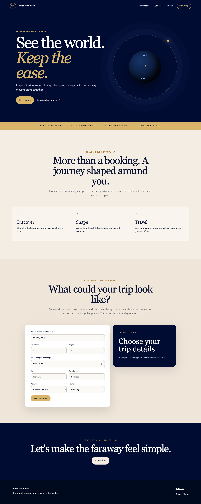
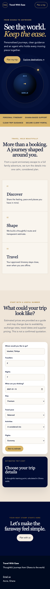
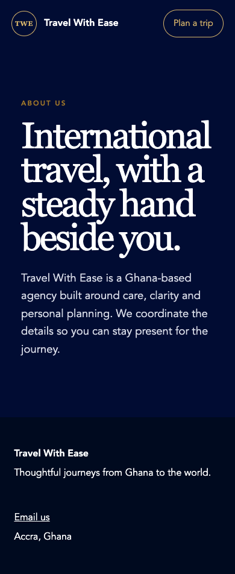
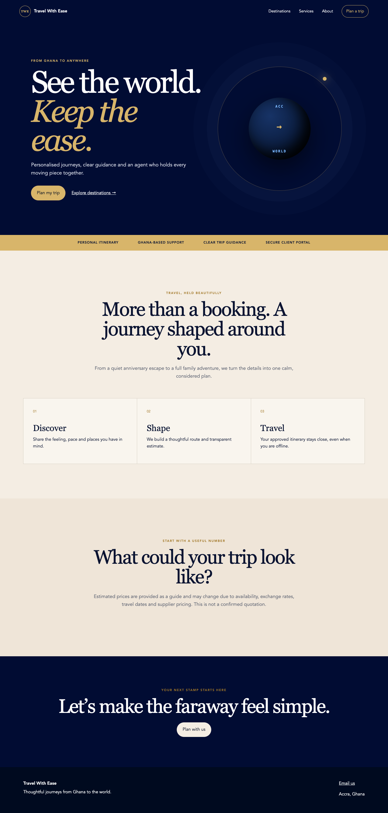

# Travel With Ease visual implementation audit

Date: 2026-10-10\
Mode: combined UX, visual design and screenshot-supported accessibility audit\
Baseline: [`Travel_With_Ease_Solution_Roadmap.md`](../../Travel_With_Ease_Solution_Roadmap.md)\
Scope: current public Astro website and estimator entry flow; portal styling was inspected in code but not included in the public-site screenshot flow.

This is the retained 2026-10-10 evidence snapshot, not a new audit. The
[governing standard](../../design-engineering-standard.md), aligned 2026-10-11,
supersedes its recommendations where applicable: React Bits candidates are
conditional examples rather than an exclusive two-component allowlist, and
approvals gate dependent work rather than every implementation task. Screenshot
findings and the original prioritisation remain historical evidence.

## Verdict

The current implementation is a useful semantic scaffold with the approved palette, clear public/private boundaries and a focused Astro/React split. It is not ready to become the launch visual direction. It relies on the exact patterns the October baseline rejects: CSS-generated hero art, a gradient/glow treatment, repeated uppercase kickers, oversized serif headings, repeated equal thirds, card-like form surfaces and no real travel photography.

The implementation also conflicts with the current product baseline. The site presents an estimator, secure client portal and offline itinerary promise even though those capabilities are deferred. The estimator action is currently broken: clicking `See my estimate` produces `Cannot convert undefined to a BigInt` and removes the interactive surface.

## Capture method and limits

Evidence was captured from the local website at `1440 × 1000` and `390 × 844` using Playwright with system Chrome, `en-GH`, `Africa/Accra` and reduced motion enabled. The Astro development toolbar was removed before capture because it is not production UI.

Screenshots support visible layout and content findings only. They do not prove WCAG compliance, screen-reader output, production image performance, actual device behaviour or browser coverage. No final licensed photography, CMS content, packages, testimonials, map data or production fonts were available to audit.

## Numbered flow

### 1. Homepage, desktop — needs major revision

Strengths:

- Navy, cream and gold establish a coherent base palette.
- The primary action is visible and the top-level hierarchy is understandable.
- Core public copy is server-rendered Astro content; the estimator is a focused island.

Findings:

- The orbit/globe is CSS art with a radial gradient, glow and multiple circular decorative layers. It feels generic and directly contradicts the photographic editorial direction.
- Four of five major homepage sections repeat a kicker, large centred heading and short paragraph. The rhythm becomes predictable rather than art-directed.
- `Discover / Shape / Travel`, the estimator surfaces and destination/service rows all lean on equal panels or cards.
- There is no licensed travel photography, featured package content, travel footprint, journal, FAQ or approved testimonial content from the roadmap sequence.
- `Secure client portal`, `approved itinerary`, `offline` and `transparent estimate` are unsupported/deferred claims that require removal or substantiation.
- Large vertical gaps and display sizes make the page long without adding information.

Accessibility risks visible from the implementation:

- Small gold kicker text on cream is about `3.44:1`, below the `4.5:1` AA threshold for normal text.
- Links and buttons do not share an explicit `:focus-visible` system.
- The CSS globe is exposed as an informative image even though it does not convey useful content.

### 2. Homepage, mobile — at risk

Strengths:

- The main CTA remains reachable.
- Form fields reflow into a single column and remain visibly labelled.

Findings:

- Destinations, Services and About are hidden at the mobile breakpoint with no menu replacement. Mobile users lose the primary information architecture.
- The page becomes a very long stack of similarly shaped blocks; the same desktop composition is collapsed rather than re-art-directed.
- Hero and section titles dominate narrow screens, while supporting copy becomes comparatively small.
- The trust strip wraps into dense all-caps claims and occupies valuable early-page space.
- The estimator fills a substantial portion of the mobile page even though the approved October roadmap defers it.

Accessibility risks:

- Hidden navigation creates a discoverability and keyboard-access gap.
- Several compact controls and navigation actions need verified `44 × 44px` targets.
- Full keyboard, zoom/reflow and screen-reader testing remains outstanding.

### 3. Destinations, desktop — incomplete and unsubstantiated

Strengths:

- The page has a clear heading and direct links back to the enquiry entry point.
- Simple markup should remain easy to index.

Findings:

- Six hardcoded city names appear as equivalent offers without content, packages, imagery, availability or evidence that they are approved business destinations.
- The page repeats the oversized navy title field and a three-column grid used elsewhere.
- `Plan this journey` routes every city to the same generic homepage anchor and does not preserve destination context.
- The roadmap calls for destination/package discovery and package detail pages, not a placeholder matrix.

### 4. Services, desktop — needs revision

Strengths:

- Copy is brief and easy to scan.
- The three service categories are plausible information groupings, subject to client approval.

Findings:

- The page is only a giant heading plus three equal panels. It has no proof, process, Ghana-specific detail, imagery or useful next step within each service.
- The layout is indistinguishable from the destination grid and reinforces a template-generated feel.
- The title consumes most of the first viewport without communicating more than one sentence.

### 5. About, mobile — structurally thin

Strengths:

- The Ghana-based positioning is explicit and concise.
- Text contrast on the navy field is strong.

Findings:

- The entire page is one large heading and one paragraph followed by the footer. It does not yet establish founder/team credibility, experience, process or a human point of view.
- The same kicker/oversized-heading template is used again.
- The desktop information links are again unavailable on mobile.

### 6. Estimator action — critical failure

Health: broken.

- Before interaction, the form is present. After `See my estimate`, the entire `.estimator-grid` disappears and leaves a large blank section.
- Playwright captured the page error `Cannot convert undefined to a BigInt` at `Estimator.jsx` formatting.
- Code inspection shows the API returns a canonical success envelope while the browser client defaults to raw-response mode; the component reads `lowMinor` and `highMinor` as if they were top-level properties. The same response-mode assumption should be reviewed in the portal lead request.
- This is a P0 if the estimator remains visible. The October baseline defers the estimator, so the product decision is whether to remove/feature-flag it now or separately re-approve and repair it.

## Standards violations summary

| Severity | Current pattern | Standard affected | Recommended direction |
| --- | --- | --- | --- |
| P0 | Estimator crashes and disappears | Reliable forms, accessible status/error recovery | Remove/flag per scope or repair contract with an error boundary and tests |
| P0 | Estimator and advanced capability claims contradict the October baseline | Truthful content and scope control | Product owner decides current launch scope before redesign |
| P0 | Mobile hides all informational navigation | Navigation and mobile accessibility | Add an accessible disclosure/menu preserving the same routes |
| P1 | CSS orbit, radial gradient and glows replace photography | Imagery and visual language | Approved photographic hero with solid-colour composition |
| P1 | Kicker → oversized heading → paragraph repeats | Editorial hierarchy | Use kickers sparingly; vary alignment, scale and section composition |
| P1 | Repeated equal thirds and card-like surfaces | Layout and component restraint | Asymmetric grid, image/text pairings, lists and editorial bands |
| P1 | Hardcoded destinations and unsupported claims | Content integrity | Publish only approved CMS-backed facts and packages |
| P1 | Small gold text on cream fails normal-text contrast | WCAG 2.2 AA target | Navy labels or approved darker accent |
| P1 | No explicit global focus-visible treatment | Keyboard accessibility | Consistent high-contrast focus ring and target sizing |
| P2 | Generic Georgia/Inter fallback pairing | Typography and brand distinctiveness | Approve and self-host an intentional editorial pairing |
| P2 | Sparse About/Services content | Trust and reassurance | Add approved human, process and proof content without invented claims |

## Prioritised change plan

### P0 — decide and stabilise before visual implementation

1. Approve the October roadmap as the active scope and decide the estimator's fate.
2. Remove or substantiate client-portal, offline-itinerary, destination and service claims.
3. If the estimator remains, align the API-client response contract, add an error boundary and cover successful/error states in browser tests.
4. Restore complete mobile navigation.

### P1 — establish the visual system

1. Approve typography and photography/licensing.
2. Replace the CSS-art hero with a real photographic composition.
3. Recompose the homepage to the roadmap's package → footprint → process → journal → FAQ/testimonial sequence.
4. Replace repeated equal thirds with purposeful editorial layouts.
5. Implement the semantic colour, spacing, focus, button, form, image and responsive standards.
6. Convert hardcoded public offers to approved, source-backed content.

### P2 — refine only after static approval

1. Prototype no more than the two allowlisted React Bits effects.
2. Measure bundle and runtime impact before adoption.
3. Add approved visual-regression, accessibility, keyboard, reflow and performance evidence.

## React Bits recommendation

Use no React Bits effect in the initial static redesign. After composition approval, permit a proof of concept for `Split Text` on one hero line and `Fade Content` on one featured editorial pairing only. Both must leave semantic Astro content visible without JavaScript, respect reduced motion and introduce no layout shift. Reject Spotlight Card, animated backgrounds, glow/cursor effects, 3D and WebGL. Full conditions are in the [design standard](../../design-engineering-standard.md#motion-and-react-bits).

## Trade-offs

- Real licensed photography increases content lead time and asset governance, but it is essential to credibility and the approved art direction.
- A distinctive self-hosted type pairing adds font bytes; subsetting and limiting weights trades flexibility for performance.
- Removing the estimator reduces interactive novelty but aligns launch scope and avoids presenting a broken/deferred quotation tool.
- Minimal React islands reduce animation options but protect discovery, accessibility and mobile performance.
- CMS-backed truth slows placeholder-driven page creation but prevents unsupported offers and claims.

## Decisions requiring approval

1. Confirm the October roadmap supersedes the previous estimator-led Phase 1 public experience.
2. Remove/feature-flag the estimator, or separately re-scope and repair it?
3. Approve `Newsreader` + `IBM Plex Sans`, or select another licensed pairing.
4. Approve the image licensing source/budget and initial hero/package asset set.
5. Supply the verified packages, destinations, indicative prices, testimonials, trip-footprint data and business claims allowed at launch.
6. Approve removal or evidence for `Secure client portal` and offline-itinerary language.
7. Approve the mobile disclosure navigation pattern.
8. Approve a static editorial wireframe before any React Bits proof of concept.

## Files inspected

Product and architecture:

- `docs/apps/travel-with-ease/Travel_With_Ease_Solution_Roadmap.md`
- `docs/apps/travel-with-ease/architecture.md`
- `docs/apps/travel-with-ease/roadmap.md`
- `docs/apps/travel-with-ease/security.md`
- `docs/apps/travel-with-ease/env.md`
- `docs/apps/travel-with-ease/implementation-notes.md`
- `docs/apps/travel-with-ease/progress-log.md`
- `docs/decisions/travel-with-ease-foundation.md`

Public website:

- `apps/travel-with-ease-web/src/layouts/BaseLayout.astro`
- `apps/travel-with-ease-web/src/pages/index.astro`
- `apps/travel-with-ease-web/src/pages/about.astro`
- `apps/travel-with-ease-web/src/pages/destinations.astro`
- `apps/travel-with-ease-web/src/pages/services.astro`
- `apps/travel-with-ease-web/src/pages/404.astro`
- `apps/travel-with-ease-web/src/components/Estimator.jsx`
- `apps/travel-with-ease-web/src/styles/global.css`
- `apps/travel-with-ease-web/astro.config.mjs`
- `apps/travel-with-ease-web/package.json`
- `apps/travel-with-ease-web/appSystem.js`
- `apps/travel-with-ease-web/public/_headers`
- `apps/travel-with-ease-web/public/_redirects`
- `apps/travel-with-ease-web/public/robots.txt`
- `apps/travel-with-ease-web/tests/output.test.mjs`

Portal and API boundaries:

- `apps/travel-with-ease-portal/src/App.jsx`
- `apps/travel-with-ease-portal/src/styles.css`
- `apps/travel-with-ease-portal/appSystem.js`
- `apps/travel-with-ease-portal/package.json`
- `apps/travel-with-ease-api/src/app.js`
- `apps/travel-with-ease-api/src/server.js`
- `apps/travel-with-ease-api/src/validation.js`
- `apps/travel-with-ease-api/src/estimator/service.js`
- `apps/travel-with-ease-api/src/security/securityHeaders.js`
- `apps/travel-with-ease-api/appSystem.js`
- `apps/travel-with-ease-api/package.json`

Registries and shared conventions:

- `packages/config/src/monorepoApps/appRegistry.js`
- `packages/config/src/projectRegistry/projectRegistry.js`
- `packages/theme/README.md`
- `packages/theme/src/index.ts`
- `packages/theme/src/system.css`
- `packages/ui/README.md`
- `packages/ui/src/index.ts`
- `packages/security/src/index.js`
- `packages/api-client/src/browser.ts`
- `packages/api-client/src/request.ts`
- `packages/validation/README.md`
- root `package.json`
- repository `AGENTS.md`

The current working tree was compared read-only with local `develop`; Travel With Ease application files matched that baseline during the audit. The only tracked Travel-related difference shown by that comparison was the application registry, while the newly supplied roadmap was untracked. No branch checkout or unrelated edit was performed.
