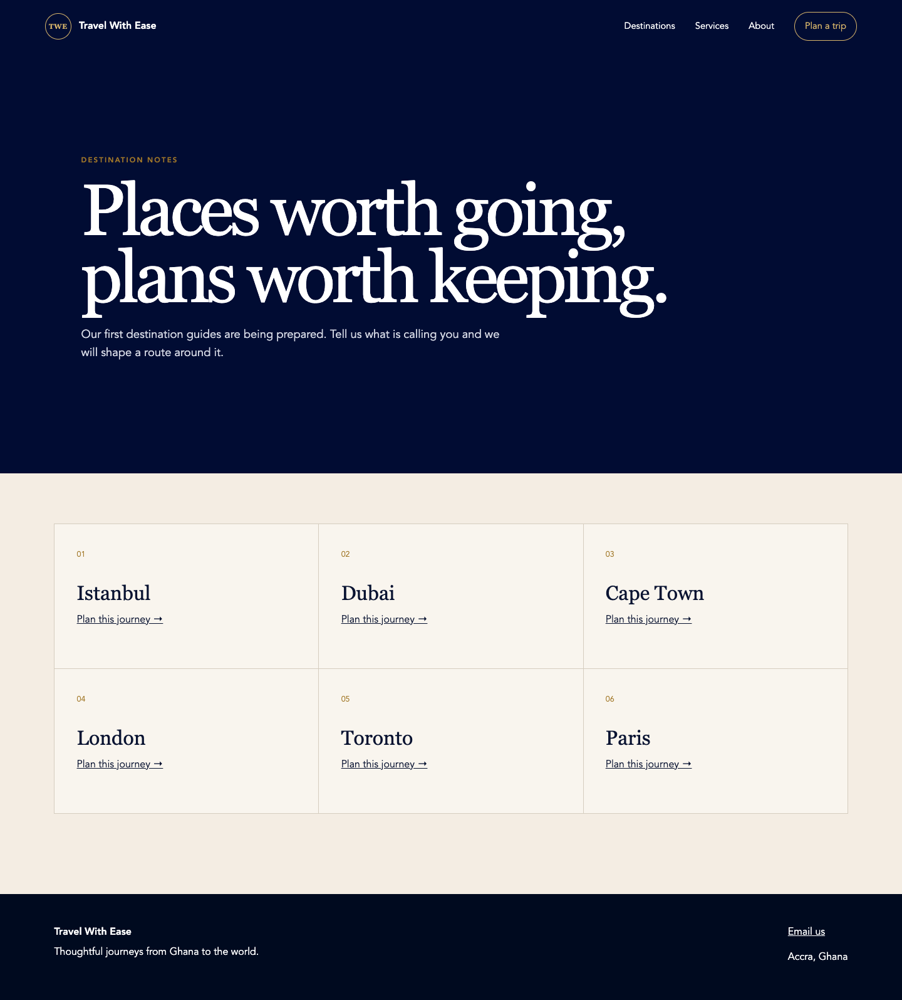
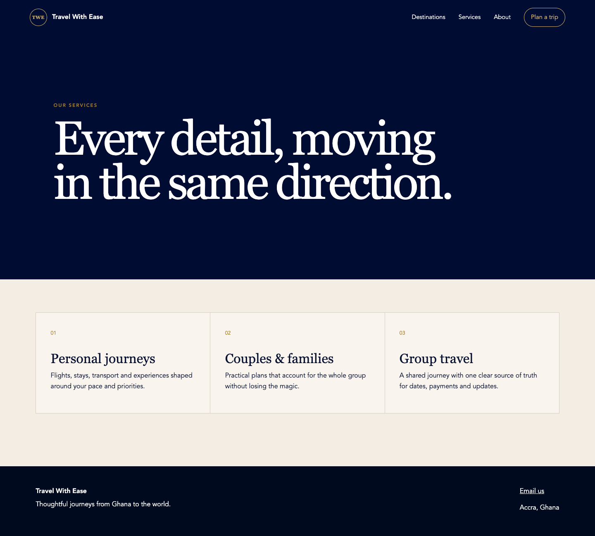
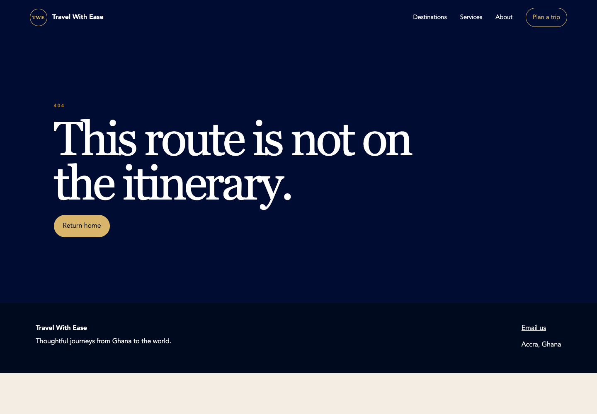
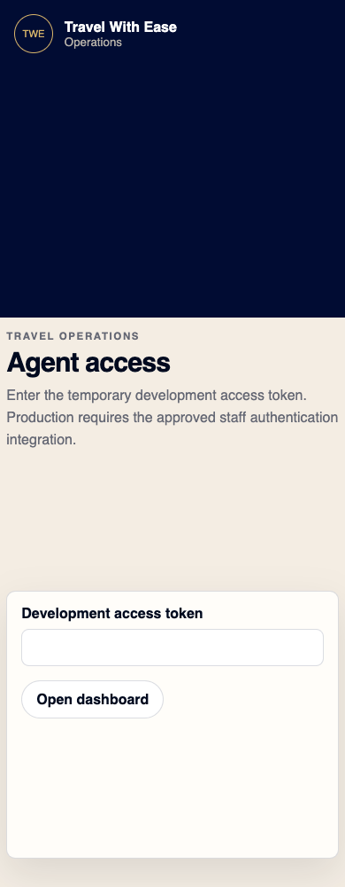
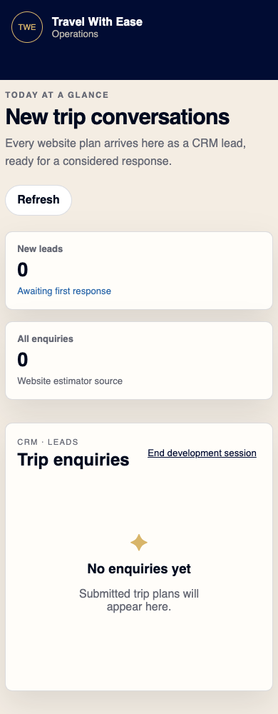

# Travel With Ease — repository audit and MVP target

Date: 2026-10-11. Owner task: [TWE-016 — Codebase gap analysis and implementation backlog](https://trello.com/c/VGWgpkCy).
Status: code-backed assessment and proposed implementation decisions; not release approval.
Companions: [implementation plan](./implementation-plan.md), [governing standard](./design-engineering-standard.md), [documentation index](./README.md).

## Executive assessment

Keep the existing Astro / React-Vite / Express workspaces. They are a useful local foundation, not a functioning MVP or a production system. Four public content pages and a 404 render; the only enquiry journey is estimator-led and fails on the API response envelope. The staff portal is one development-token screen and one lead dashboard, not a CMS. PostgreSQL exists only as unapplied SQL design in the repository: no database driver, runtime adapter or migration runner is present in the API workspace.

The highest-priority work is deployed-environment safeguards, PostgreSQL and staff identity, followed by independent enquiry persistence, content publishing and media. Preserve deferred estimator/currency code but remove it from the MVP's navigation, normal startup dependencies and customer journey through an explicit compatibility decision. Do not replace the framework or build a CRM/ERP.

The MVP in Prompt 02 is the implementation scope for this plan. The October roadmap's legal/commercial approval caveats still apply; this audit does not assert client sign-off. Trello card placement, an app registry entry, SQL file or passing build is not evidence of completion.

## 1. Evidence, baseline and limits

- Inspected branch: `feat/reebs-water-modules-stabilization`, HEAD `3075ed582`; local `develop` `5d09f1c0b`. `git diff develop --name-only -- apps/travel-with-ease-web apps/travel-with-ease-api apps/travel-with-ease-portal` returned no differences. This is comparison with the local baseline, not a claim that remote develop is current. No branch switch/fetch/merge occurred.
- Preserved pre-existing modified architecture, env, progress log, roadmap and security docs, plus untracked standard, baseline Markdown/DOCX/PDF and prior audit. Only TWE documentation/evidence is changed by this task.
- Read-only Trello search verified TWE-001 through TWE-026 on the Travel With Ease board, including TWE-013/016 and the implementation cards linked in the plan. No cards were created, moved or marked complete. Historical `TWE-001`–`TWE-010` technical decisions in roadmap.md are a separate numbering namespace; do not confuse them with Trello tasks.
- Fresh Playwright/system-Chrome captures used the already-running local web/portal, 1440×1000 and 390×1000 viewports, `en-GH`, `Africa/Accra`, reduced motion. All API calls in browser captures were intercepted with synthetic canonical responses; no production/customer data or real credential was used. The Astro toolbar was removed from captures. Each saved screenshot was opened and inspected.
- API probes used a separate ephemeral loopback server, memory repository and synthetic failing provider. They did not modify the running API or persisted records. No live email, upload, identity-provider, database or deployment was exercised.
- Browser samples are not device-lab, screen-reader, zoom, WCAG certification or Core Web Vitals results. Missing MVP flows cannot be tested before implementation. Existing local servers were left running; audit browser/probe processes closed.
- Cloudflare/Railway account resources, secrets, domain ownership, DNS/TLS, GitHub branch protections and deployed backups were not accessible/verified. No live deployment is asserted absent simply because repository configuration is missing.

### Verified checks

| Check | Result and meaning |
| --- | --- |
| `pnpm --filter '@faako/travel-with-ease-*' run build` | All three passed; Astro emitted five pages. API build is syntax checking, not integration compilation. |
| Same filter `run lint` and `run typecheck` | Passed. Astro: 0 errors/warnings/hints. API checks only server/app syntax; portal has `checkJs:false`, so this does not establish typed API payload safety. |
| Same filter `run test` | Web 1/1, portal 1/1 passed. API initially 4/6 because sandbox denied loopback listening. |
| API tests rerun with permitted loopback | 6/6 passed. Tests use memory storage and fixed currency data. |
| Fresh browser success-envelope probes | Estimator throws `Cannot convert undefined to a BigInt`; its action disappears. Portal receives one synthetic lead but shows zero and its empty state. |
| Malformed JSON probe | HTTP 400 HTML with `SyntaxError` detail in the local non-production runtime; no canonical error envelope. Production stack visibility depends on `NODE_ENV`, not merely `APP_ENV`. |
| Request ID / unknown path | Valid incoming request ID replaced; 404 JSON lacks request-ID metadata, though response header exists. |
| Failed currency provider | Valid inquiry returns 503 and memory repository remains empty. |
| Schema / factory probes | `2027-99-99` accepted by date schema; `createApp` accepts a development token in production mode, although normal `server.js` startup still refuses production. |

Only these focused checks were run; no fresh full-monorepo gate, dependency-advisory scan, production test or database migration success is claimed. Portal build: JS 280.67 kB (85.78 kB gzip), CSS 120.64 kB (17.78 kB gzip). These are bundle outputs, not measured page performance. Shared UI compatibility CSS is a material part of the portal baseline; profile usage before pruning it.

Additional read-only repository checks: app registry passed; workspace-manifest validation passed for 36 packages; project-registry check exited 0 with an existing warning that REEBS Water lacks project metadata. That unrelated warning was not repaired here.

## 2. Current-state architecture

| Surface | Actual implemented path | Boundary/gap |
| --- | --- | --- |
| Public Astro | `index`, `about`, `services`, `destinations`, `404`; common layout and CSS; static output plus sitemap integration | Hardcoded content, example canonical/mail domain, no content collections/CMS reads or real imagery |
| React island | `Estimator.jsx`, `client:load`; estimate then conditional contact form | Raw envelope consumed as payload; no independent personalised/package form |
| Express | `server.js` wires configuration → currency provider/cache → estimator → file lead repository → `createApp` | Every real inquiry recalculates currency; production explicitly blocked; staging value not validated |
| Persistence | `FileLeadRepository`: serial promise queue, restrictive local permissions, temporary write + rename; memory adapter for tests | Single-process local JSON, no tenant field or DB transactions; rejected queue is not recovered; no multi-process durability guarantee |
| Staff React | Shared UI provider, token in `sessionStorage`, one lead dashboard/table/refresh action | No router usage despite router dependency; Dashboard and Leads both point at `/`; no secure sessions/RBAC or editing |
| Shared platform | Canonical API envelopes, validation primitives, security middleware used; logger declared | Logger not wired; audit helpers not imported; shared audit package is not a persistence writer |
| Deployment | Public `_headers`/`_redirects`, dev proxies, app registrations and affected CI | No TWE deploy/migration/backup automation or verified hosted services |

Current request sequence: visitor → Astro island → estimate/currency → contact form → inquiry route → currency again → JSON lead; staff token → unscoped full lead list → browser envelope mismatch. A public visitor cannot read leads without the configured token, but any holder of that token can read every stored lead.

## 3. Target-state architecture

Keep the three workspaces and app-owned domain code. Public pages remain static, crawlable Astro. React islands cover the two forms and useful map interaction only. React portal provides Dashboard, Enquiries, Website Content, Packages, Travel Journal, Travel Footprint, Media Library and Settings. “Client management portal” means the agency's staff CMS, not traveller accounts.

| Producer / action | Server responsibility | Durable result / consumer |
| --- | --- | --- |
| Visitor personalised/package enquiry | Validate discriminated schema, published package, Turnstile and abuse limits; idempotent transaction | PostgreSQL enquiry + notification outbox; confirmation after commit, independent of email/currency |
| Staff identity | Reviewed provider login, local staff allowlist, secure server session, permissions and organisation scope | Auditable authenticated access; no browser-stored bearer secret |
| Staff edits | Validate typed page/package/article/settings records, media references, optimistic version | Draft revision; protected preview; no public draft API |
| Staff publishes | Validate revision; audit + durable publication job; authenticated build trigger | Pinned content snapshot → static Astro build → deployment confirmation → visible publication status |
| Notification worker | Claim outbox jobs, send via Resend, retry with bounded backoff/deduplication | Delivery status/error code; enquiry remains durable on failure |
| Media upload | Staff auth, bounded content inspection/re-encoding, rights metadata, random key | Private R2 drafts; only approved public derivatives used by published content |
| Footprint editor | Validate ISO country, approved evidence and deduplication key | Audited aggregate activity; public country totals only, one completed + confirmed-upcoming intensity |
| Operations | Scheduled encrypted DB exports, private off-site storage, restore tests, health/alerts | Recoverable environment, documented RPO/RTO and release rollback |

Use PostgreSQL-backed jobs for low-volume email/publication work; do not introduce Redis, a generic event bus or separate analytics service without measured need. A worker command may run from the API workspace as a separately supervised process. Reuse transaction and logging helpers, not another app's database/session implementation.

## 4. Implementation gap matrix

`Partial` means scaffold exists but acceptance is not met; `Missing` means no implementation found in the inspected TWE source; `Unverified` concerns external resources.

| MVP capability | State / source evidence | Necessary next change | Plan slice |
| --- | --- | --- | --- |
| Home/About/Services | Partial: W `src/pages/*.astro` | Approved editorial content, photography, navigation and enquiry CTAs | B1/B3 |
| Destinations/packages | Partial: six hardcoded names link to the same estimator | Published package listing with actual destinations, terms and images | B2/B3 |
| Package details | Missing: no dynamic route | Slug page, date/tier/from-price disclosures and contextual enquiry | B2/B4 |
| Journal | Missing | Staff authoring + crawlable list/detail + manual social links | B5 |
| Interactive world map | Missing | Validated country activity management, aggregate API, accessible map/list | B6 |
| FAQs/Contact/legal | Missing | Typed content, approved contact/WhatsApp, privacy/terms/cookie controls | B3/B7 |
| Personalised enquiry | Partial: estimator prerequisite, schema and envelope mismatch | Independent form and transactional inbox/outbox persistence | B4 |
| Package enquiry | Missing | Distinct form/schema with server-validated package ID and snapshot | B4 |
| WhatsApp / confirmation / feedback | Missing or broken: placeholder mail, no WhatsApp, raw inquiry reference | Approved click-to-chat; post-commit reference; field errors and recovery | B3/B4 |
| Dashboard | Partial: two KPIs and lead table | Operational counts, honest loading/error/empty states, module navigation | A3/B4 |
| Enquiries | Partial: unscoped read-only leads only | Scoped paginated list/detail; New/Contacted/Closed; audited updates | B4 |
| Website Content / Packages / Journal | Missing | Typed editors, revisions, publish/unpublish/revert and preview | B2/B5 |
| Footprint / Media Library / Settings | Missing | Audited activity editor, safe uploads/rights, allowlisted settings | A4/B2/B6 |
| Staff auth / session / permissions | Development-only shared token | Reviewed MFA-capable identity and revocable server sessions | A3 |
| PostgreSQL / migrations | SQL only: A `db/001_phase1.sql`; no driver | Runtime adapter, minimal MVP schema, migration history and tests | A2 |
| Publishing / notifications / media | Missing | Durable workers, static build acknowledgements, R2 and Resend adapters | A4/B2/B4 |
| SEO / analytics | Partial: metadata/sitemap/JSON-LD only | Real origins, schema/OG, sitemap accuracy, consent-aware GA4 | B7 |
| Security / audit | Partial: schemas, body limit, headers, token and in-memory limiter | Sessions/authz, safe errors, request tracing, stored audit and retention | A1–A3/B8 |
| Backups / monitoring / staging | Missing in TWE code, external state unverified | Isolated resources, health/readiness, scheduled restore-tested exports | A5/B8 |
| Estimator/currency/full CRM | Implemented foundation but deferred | Preserve source/tests; isolate from launch flow and runtime | A1/B4 |
| Payments/booking/customer accounts/AI/trip management/automated social | Excluded, not MVP gaps to implement | No launch routes/navigation/tables merely for historical roadmap coverage | All |

## 5. Public pages, components and UI/UX assessment

Common strengths: server-rendered headings, landmarks, skip link, visible form labels, an existing brand palette and native controls. Weaknesses are composition/content and broken workflows, not grounds for a framework rewrite. No React Bits or animation library is installed; unnecessary dependencies are not the current primary problem. The portal's unused router dependency can support real MVP routes; do not remove it merely for tidiness.

| Page/component | Purpose and actual behaviour | Mobile/accessibility/SEO/performance/reuse assessment | Specific change; launch required? |
| --- | --- | --- | --- |
| W `src/pages/index.astro` | Marketing → `#plan`; estimator-centric; unsupported client portal/offline itinerary claims | Crawlable; one hydrated island; generic repeated section rhythm, CSS globe not useful informative content; tall mobile page | Retain Astro layout, replace hero art with licensed photography and approved homepage composition; replace estimator CTA/form; remove deferred claims. Yes |
| W `src/pages/about.astro` | One large heading and generic agency paragraph | No meaningful business evidence/images; narrow text wraps but display dominates mobile; title/description present | Approved human story and team/source material; moderate heading/spacing. Yes |
| W `src/pages/services.astro` | Three equal service panels | Generic copy including “payments and updates”; no detail CTA or imagery; stack-only responsive layout | Explain approved services and enquiry process; clarify offline agency services versus site features; vary image/text composition. Yes |
| W `src/pages/destinations.astro` | Six destination names, every CTA `/#plan`, no selected destination carried | Repeated thirds; names are not package inventory; basic metadata but little indexable useful content | Preserve URL; populate published packages/destination copy and detail links; approved prices only. Yes |
| W `src/pages/404.astro` | Missing path returned 404 in local capture; home link works | Reuses oversized hero and index/follow metadata; static-host fallback still needs deployment test | Keep simple recovery; noindex error output, verify real hosted 404 and avoid sitemap inclusion. Yes; visual polish lower priority |
| W `src/layouts/BaseLayout.astro` | Shared shell, navigation/footer, metadata, escaped JSON-LD | Mobile CSS hides all primary links except CTA; no menu/current-page semantics; example origin/email; no OG image; no staging robots switch | Accessible disclosure nav, approved contact/legal links, validated real origin, route metadata/noindex and image. Yes |
| W `src/components/Estimator.jsx` | Collects trip choices, then estimate, then contact | Wrong raw response shape crashes render; submit also assumes unwrapped reference; errors not field-linked; no independent form/no-JS submission path | Do not redesign estimator: remove from MVP entry, preserve deferred code; use explicit normalized response mode in new form/client and regression coverage. Yes |
| W `src/styles/global.css` | Shared layout, fields, brand styles | Gradient/glow orbit; 1.4rem card radius/shadows; 7.5rem heading ceiling; repeated kickers; small `#a27828` on cream ~3.44:1; no unified button/link focus-visible styling | Apply approved tokens/type scale; functional cards only, smaller spacing and licensed images; navy small labels, visible focus. Yes |
| P `src/App.jsx`, `src/styles.css` | Token entry → one dashboard; shared UI primitives | Mobile hides navigation; grid leaves large blank masthead; both links active at `/`; raw `data.items` loses returned rows; false empty state during failures/loading | Retain shared provider/table primitives, add real routes and responsive shell, server session, honest async states and normalized API client. Yes |
| P `src/leadView.js` | Formats legacy lead rows, omits email/notes from display | Useful pure mapper, but source API still sends all personal fields; full-CRM stages and browser timezone assumptions | Adapt to minimal inbox DTO, explicit Accra display and three statuses; do not mistake display omission for data minimisation. Yes |

### Fresh screenshot walkthrough

User goals: understand the agency, explore an offer, submit an enquiry, then staff review it. Target WCAG 2.2 AA; the captures below support visual/interaction findings only. No meaningful animation was observed beyond smooth scroll (reduced-motion CSS disables it); do not add effects as an audit remedy.

1. **Home desktop — needs revision.** Clear CTA and coherent palette, but decorative globe/glow, large typography, repeated kickers and unsupported claims weaken trust. Launch: replace composition/content, not framework.

2. **Home mobile — navigation gap.** No horizontal overflow at 390px, but About/Services/Destinations disappear from primary navigation with no replacement. Tall decorative and stacked sections delay the form. Launch: functional menu and compact editorial layout.

3. **Destinations — incomplete.** Six repeated panels all lead to the same estimate rather than a relevant package. Launch: real published package content/detail/context.

4. **Services — thin content.** Large headline and thirds repeat the homepage without helping visitors choose a service. Launch: concise specific copy, supported claims and useful enquiry links.

5. **About mobile — readable but incomplete.** No overflow at 390px; little evidence of the actual agency and oversized heading. Launch: approved story/imagery and accessible mobile navigation.

6. **404 — basic recovery works locally.** HTTP 404 and home action verified. Hosted fallback, noindex and sitemap treatment remain to test.

7. **Estimate action — blocked.** A synthetic valid `{ok:true,data:...}` response triggers a BigInt render error and removes the island. Contact/confirmation cannot be reached through this flow. Launch: independent enquiries plus response-contract regression tests.

8. **Staff access — development only.** Clearly labels temporary token, but is not real staff sign-in. Large empty mobile header consumes space. Launch: reviewed authentication and shell.

9. **Staff inbox — misleading empty state.** After synthetic token entry and a mocked canonical response containing one record, dashboard reports zero. This verifies rendering/contract failure, not successful authentication. Launch: normalize data, distinct async states and real inbox tests.

Package detail, journal, map, CMS edit/publish, real login and both MVP confirmation flows have no implementation to capture. Keyboard/screen-reader checks, 320px reflow, 200% text/400% zoom, real mobile touch, full contrast coverage and production network performance remain explicit acceptance requirements, not completed findings.

## 6. API change assessment

| Existing endpoint | Actual behaviour | Proposed treatment |
| --- | --- | --- |
| `GET /healthz` | Process-alive JSON; no database check | Keep liveness stable; add bounded dependency readiness endpoint without secrets |
| `POST /api/public/estimate` | Zod → estimator → currency; rate-limited; canonical response | Deferred route behind explicit development/feature boundary; do not use for enquiries; inventory consumers before disabling |
| `POST /api/public/inquiries` | Extends estimate schema; honeypot; recalculates rate; writes lead/inquiry; 201 reference | Keep spelling/URL; introduce versioned/discriminated MVP contract and explicit adapter/rejection policy for legacy estimator input; persist enquiry/outbox atomically without provider dependency |
| `GET /api/agent/leads` | Shared bearer comparison; returns all raw lead records | Retain only isolated legacy compatibility if needed; build session-protected `/api/agent/inquiries` with scoped paginated summaries/detail permissions |
| Unknown/errors | 404 envelope without metadata; parser/repository throws reach default handler | Central safe error mapper, request-ID propagation, explicit 400/413/500 handling |

Proposed additions (not implemented):

- `/api/auth/login`, `/callback`, `/session`, `/logout` as needed by the reviewed identity approach. Protect all unsafe cookie-authenticated routes with CSRF; never implement auth solely as portal route hiding.
- Public read-only `/api/public/content/:page`, `/packages`, `/packages/:slug`, `/articles`, `/articles/:slug`, `/travel-footprint`. Published projections only; no contact data, draft content or editor metadata. Astro uses a pinned published snapshot during builds.
- Staff `/api/agent/content`, `/packages`, `/articles`, `/travel-activity`, `/media`, `/settings`, `/inquiries`; explicit list/detail/create/update actions, bounded pagination, optimistic concurrency and auditable mutations. Separate revision/preview/publish/unpublish/revert operations and publication-job status.
- Protected build snapshot retrieval and deployment acknowledgement; authenticated service scope, not a public rebuild URL. Email/publication workers and backups are commands, not unauthenticated public endpoints.

New enquiry DTO: `type: personalised|package`, contact name and approved contact fields, optional preference/date range, party size, bounded budget/preferences/notes, notice version/acknowledgement and separate optional marketing choice, bot token and idempotency key. Package input requires ID; server verifies active published revision and snapshots package title/date/tier references. Client must not set organisation/status/price authority. Confirmation returns opaque reference and receipt status, never the full personal record. Validate calendar dates/range and maximum lengths; the shared date regex alone is insufficient.

Use `@faako/api-client` with explicit `responseMode: 'data'` at the TWE adapter/request boundary; do not change shared defaults and break other apps. API tests currently assert `.data.items`, while consumers read `.items`; add consumer integration tests. CORS middleware currently permits GET/POST/OPTIONS; PATCH/DELETE staff APIs require a deliberate app-scoped method policy, not a blanket shared change.

## 7. Proposed minimal data model

Logical model, not an applied migration. UUID identifiers, UTC `timestamptz`, schema validation and DB constraints; organisation derived server-side. One configured agency per environment, no organisation-management UI. Include `organisation_id` in protected rows and scoped unique keys/FKs; do not rely on a browser-provided tenant or a single-user assumption.

| Entity | Essential fields and constraints | Relationships / access |
| --- | --- | --- |
| `staff_users` | ID, organisation ID, identity issuer/subject unique, display name, verified email, role `owner|editor`, active, timestamps | External provider owns credentials/MFA; explicit invitation/allowlist, no automatic staff enrolment |
| `staff_sessions` | ID, staff ID, unique hashed opaque token, expires/last-seen/revoked timestamps, CSRF binding | Server only; expiry/revocation checked per request; no raw provider tokens in browser |
| `content_items` | ID, org, kind `page|package|article|settings`, stable key/slug, draft/latest revision pointers, published revision pointer, optimistic version | Unique org/kind/slug. This is four fixed schemas, not a user-configurable page-builder/EAV system |
| `content_revisions` | ID, item ID/org, revision number, typed validated JSONB payload, schema version, editor, created time, change reason | Unique item/revision; immutable history, same-org FK. Pages: allowlisted sections/FAQs/legal copy. Packages: country, dates, tier, original-currency integer from-price, disclosures/inclusions/terms, media references. Articles: title/excerpt/body, tags, media, SEO, related package/source link. Settings: approved public contact/social values only, never secrets |
| `media` | ID/org, opaque object key, type/size/hash/dimensions, derivative manifest, alt/focal point, rights/source/credit/approval, state, uploader/time | Private originals/quarantine; approved public derivatives only. Validate revision references, block deletion of in-use published assets |
| `enquiries` | ID/org, unique reference, type, package item/revision nullable with snapshot, contact, dates, party/budget/preferences/notes, status `new|contacted|closed`, notice evidence, optional marketing consent, request/idempotency key/hash, timestamps | Package relation mandatory for package type; list projection minimal, detail authorized; no lead/customer/traveller/booking tables for MVP |
| `notification_outbox` | ID/org, enquiry ID, event key unique, channel/template version, state, attempts, next attempt, lease/lock, provider ID, bounded error code, timestamps | Insert in enquiry transaction; reference personal data instead of copying full submissions into payloads; bounded retries and explicit operator retry |
| `country_travel_activity` | ID/org, ISO country, positive count, status `completed|confirmed_upcoming|cancelled`, period, source reference, deduplication key, publication flag, version, editor/time | Unique org/source-key/country; one logical trip batch updated when status changes, not inserted twice. Imported aggregate batches need provenance and non-overlap review |
| `audit_records` | ID/org, actor/system reference, action/entity/ID, timestamp, request ID, safe metadata | App-owned append-only writer using shared audit shape; no raw before/after PII, credentials or notes; restricted read/retention policy |
| `publication_jobs` | ID/org, target environment, immutable revision manifest, state, attempts/lease, deployment ID, source SHA, requested/confirmed times, safe error | Durable rebuild/retry and reconciliation; distinguishes selected/published-in-DB content from successfully live deployment |

Also use the migration tool's schema-history table; do not invent duplicate bookkeeping. No separate tag, FAQ, testimonial, pricing engine, CRM pipeline or generic workflow tables are necessary initially. Validate JSONB by fixed kind-specific schemas and immutable revisions; approve typed JSONB versus separate package/article tables before migration. Trade-off: fewer tables and one revision lifecycle, but cross-reference validation and public projections must be explicit and tested.

Transactions: enquiry + outbox together; content mutation + audit together; publish intent + pinned manifest/job + audit together; activity adjustment + audit together. Optimistic locking returns 409 on stale edits. Publication snapshots must remain coherent across pages/packages/articles and retries; never build from an arbitrary mixture of latest drafts. Restoring a revision creates a new revision/publication, not destructive history rewriting.

Existing `001_phase1.sql` defines finance rates and CRM leads/stages/inquiries; its enquiry-to-lead FK does not enforce matching organisation IDs, and runtime records do not carry organisation IDs. No RLS or grants are defined. Do not run that SQL blindly as the MVP model. Inventory any applied schema first; preserve applied migrations, add forward migrations for MVP, and define an explicitly reviewed clean-database path. Use parameterised SQL, separate migration/runtime roles and cross-org integration tests. Existing file data import is not authorized; if needed, inventory/protect it and obtain a separate migration decision.

## 8. Security risk register

Ratings describe risk if the scaffold handles real data, not a claim of a live exploit. There is no verified critical production exposure. High findings block real-data staging/production acceptance. All mitigations are proposed, not implemented. Locations use repository-relative paths with line numbers from this audit; W/A/P aliases are expanded in section 12.

| ID / severity / rule | Evidence and impact | Fix, interim mitigation and uncertainty |
| --- | --- | --- |
| S01 High — fail-closed deployment | A `src/server.js:11–12,26–29`: only `environment === 'production'` throws; all other strings select file/token adapters. A `src/app.js:32` allows production factory with any nonempty token. Misconfigured deployment could expose development controls and personal records. | Explicit environment schema + deployed adapter assertions in composition and factory, unknown mode rejection, reviewed session/DB. Keep current production guard; do not expose local API. Hosted exposure unverified. |
| S02 High — authentication/authorization; REACT-AUTH-001 | P `src/App.jsx:11–24` sessionStorage token; A `src/app.js:85–88` token equality → all records. No actor, expiry, revocation, MFA, permission or organisation filtering. Stolen/shared token grants whole inbox. | Reviewed identity/session and server-scoped queries; one agency still requires staff allowlist. No real customer data before replacement. Not an unauthenticated read bypass: token check does exist. |
| S03 High — persistence/data isolation | A `src/crm/repository.js:10–36` writes personal records to one JSON file; A SQL contains no grants/RLS or same-org composite FK. No live DB adapter. Loss/concurrent-instance drift and cross-scope exposure risk. | PostgreSQL transactions/constraints/least privilege, backup/restore; local synthetic data only. File permissions/rename are useful but not deployed durability. No SQL injection exploit exists in current runtime because it has no SQL execution. |
| S04 Medium — EXPRESS-ERROR-001 | A `src/app.js:43,85–92`: no terminal error middleware; malformed JSON probe returns HTML and local stack. Client error handling breaks; internals may leak if runtime mode is wrong. | Canonical safe 400/413/500 mapper, redacted diagnostics, tests with deployed NODE_ENV. No assertion that a correctly configured production Express default exposes stacks. |
| S05 Medium — tracing/logging/audit | A `src/app.js:31,37,54,80,91`: defaults `logger=console`, regenerates request ID, logs arbitrary error message, 404 omits metadata. No audit writer. Incidents and staff changes cannot be attributed reliably; future errors may contain PII/secrets. | Wire shared logger/request middleware and app-owned audit persistence; test redaction and incoming ID validation. Current probe did not demonstrate a real secret leak. Keep logs synthetic meanwhile. |
| S06 Medium — EXPRESS-AUTH-001 / abuse | A `src/app.js:13–25,35,47,85`: per-process Map has no stale-key eviction, reset on restart, shared estimate/inquiry quota, no staff throttle; trust proxy differs only for exact production. | Bounded limiter, provider-verified Turnstile, login/account/IP controls and tested proxy chain; choose shared/edge limits for multiple instances. Edge/WAF settings unverified; CORS is not bot protection. |
| S07 Medium — XSS/CSP defence | W `public/_headers:2` permits inline scripts and broad HTTPS connections; P header also broad HTTPS; W layout JSON-LD explicitly escapes `<` and React uses text interpolation. | Tight app/environment CSP with approved hashes/origins; fixed structured content or sanitized rich text, safe URLs and upload allowlist before CMS. No confirmed stored-XSS sink in current static content. Test real edge headers; do not weaken shared policy to make CMS work. |
| S08 High readiness — privacy/retention/backups | A `src/app.js:68–74,88` stores contact/notes and returns full records; repository has no expiry/deletion policy, backup or restore implementation. No notice/legal pages; no verified retention/processor controls. | Minimal list DTO, approved notice/version, retention/deletion and subject-request process, restore-tested backups. Block real-data launch; document safeguards until provider controls verified. |
| S09 Medium — environment isolation | W layout `src/layouts/BaseLayout.astro:23` always index/follow; robots allows all; no staging-specific deployment config or credentials contract implemented. | Dedicated stage DB/R2/auth/email and protected noindex surfaces; verify default provider URLs as well as custom domain. No proof that live staging is currently indexed. |
| S10 Medium — boundary validation | A `src/validation.js:9,17` inherits regex-only shared date and estimator schema; probe accepts impossible date. Frontend estimate fields are accepted but recomputed server-side. | Calendar/date-range checks and discriminated MVP schema; reject oversized/unknown fields according to contract. No authoritative price trust issue observed; avoid collecting unnecessary travel detail. |

Other assessed controls: no hardcoded production secret found in inspected source/examples (not a full secret-history scan); no active file-upload/download endpoint yet, so file security is an implementation gate, not a present exploitable upload claim. Bearer-header flow has no current cookie-based staff mutation, so classic CSRF is not the identified current defect; CSRF protection is mandatory with proposed cookie sessions. Exact CORS allowlisting suppresses disallowed browser response access but does not reject all server requests. JSON body limit is 32kb, `x-powered-by` is disabled, API responses are no-store/private through shared security middleware. TLS, encryption at rest, database credentials and backups must be verified at the deployment provider, not inferred from local HTTP. Shared middleware's forwarded-protocol handling and existing HSTS policy require topology review, not unrelated shared edits here.

### Ghana data protection: engineering versus approval

Act 843 addresses minimality/lawful processing (ss.19–23), retention/deletion (s.24), security and processor contracts (ss.28–30), compromise notification (s.31), access/correction and marketing rights. Implement minimal contact/enquiry fields, notice-version evidence, separate marketing choice, scoped access, retention/deletion and rights-request procedures, redacted logs and incident evidence. Section 31 uses “as soon as reasonably practicable”; do not substitute an assumed GDPR 72-hour deadline. These controls support compliance; they do not certify it. [Official Act text](https://csa.gov.gh/resources/Data_Protection_Act_2012.pdf).

Client/legal approval must establish controller/processor roles, lawful basis, retention periods, overseas processor/hosting arrangements, legal policies, registration and renewal status, incident contacts and any applicable supervisor obligations. DPC guidance specifically addresses registration, accountability, compliance assessments and organisational measures. Obtain Ghana-qualified review of current law and business circumstances before release; a published draft bill is not treated as enacted law. [DPC compliance guidance](https://dataprotection.org.gh/wp-content/uploads/2025/07/GUIDELINES-TO-DEMONSTRATE-DATA-PROTECTION-COMPLIANCE.pdf).

## 9. Staging architecture and infrastructure dependencies

Current status: **local foundation verified; staging and production infrastructure unverified; normal production API startup blocked**. Registries label TWE foundation/private/internal and monitoring optional with URL-variable names, not deployed origins. `docs/deployment/active-services.md` contains no TWE deployment entry. No TWE-specific Docker/Railway/Wrangler/deployment workflow was found. Existing `_headers` are intended static-host settings, not proof of applied headers. Trello TWE-004 says the domain is registered; confirm ownership/access rather than buying another domain.

| Resource | Required stage target / proof | Dependencies and production separation |
| --- | --- | --- |
| Astro site | Dedicated Cloudflare Pages project or explicitly isolated stage configuration; correct static `dist`, stage API origin, restricted review + noindex | Client account/access/domain decisions TWE-003/004; no production build hooks/secrets |
| React portal | Dedicated stage project, SPA fallback, protected session, noindex and mobile routing | A3 identity, exact stage API/CORS pairing; protection must cover default provider and custom domains |
| Express API/worker | Separate Railway stage services from same workspace; scoped root/workspace build/start; environment validation | A1/A2/A3; production NODE_ENV security behaviour with separately validated APP_ENV=staging; no dev token/file fallback |
| PostgreSQL | Separate service/database, migration role versus runtime role; synthetic seed; transaction/readiness probes | TWE-005 ownership/billing and migrations; stage credentials cannot connect to production |
| R2 | Dedicated stage draft/media and private backup buckets or separately enforced resources; scoped credentials, deletion/access tests | TWE-004/A4; never reuse production keys, objects or public backup access |
| Email | Dedicated Resend configuration/key; sink or enforced test-recipient allowlist; retry failure exercise | TWE-006 sender-domain approval; no customer mail or production mailbox by default |
| Authentication | Separate stage identity application/session secrets and allowlist; MFA/recovery/expiry tests | Provider approval; never production sessions/cookies or shared default tokens |
| DNS/TLS | Confirm owner and proposed stage web/portal/API origins; verify certificates, origin routing and CORS/cookie scope | Domain is a business input, not yet a verified DNS configuration; provider subdomains can be temporary review targets |
| Test data | Clearly synthetic staff, content, packages, enquiries, map counts; separate approved public-content import | No copied production customers, private attachments or live vendor credentials |
| CI/deployment | TWE-scoped build/test/browser + isolated Postgres tests; protected stage promotion and production approval | Monorepo CI currently builds affected code but browser jobs cover other apps; no TWE service DB configured |
| Health/monitoring | Liveness, dependency readiness, errors/latency, outbox age/failures, publish age/failures, backup age, alert drill | Reuse Faako monitoring registry; configure URLs only after verification; no bespoke analytics service |
| Rollback/restore | Previous source/artifacts, versioned publication manifest and media, additive migrations, encrypted export/restore in isolated DB | Confirm ownership and costs; production DB restore is a separate high-impact approved action |

Recommendation: dedicated stage and production resources, feature branches from develop, PR checks → develop staging candidate, release PR to main and explicit production approval with recorded SHA/tag. Current CI handles PRs to main/develop and pushes to develop; it does not prove deployment mappings or branch protection. Never deploy this unrelated feature branch by inference. Review explicit TWE files/hunks before any later commit; no force-push or blanket staging.

Astro defaults to build-time rendering; changing database content alone does not update a static site. Prefer a durable publication job and authenticated build/deployment acknowledgement over runtime SSR for this small editorial site. This is our architectural recommendation based on [Astro rendering documentation](https://docs.astro.build/en/guides/on-demand-rendering/). Cloudflare supports deploy hooks, whose URLs must be treated as secrets; a successful trigger is not a successful publish. [Cloudflare deploy hooks](https://developers.cloudflare.com/pages/configuration/deploy-hooks/). Preview URLs are public unless protected, and default preview access protection does not automatically cover all project/custom domains. [Cloudflare preview controls](https://developers.cloudflare.com/pages/configuration/preview-deployments/).

## 10. Decisions requiring approval

| Decision | Reasonable options | Recommendation and trade-off / approver |
| --- | --- | --- |
| Staff identity | Managed OIDC + app session; local passwords + maintained auth library/session; reuse another app's provider/session | Managed MFA-capable OIDC with explicit staff allowlist and Express-owned opaque DB sessions; fewer password/recovery responsibilities but vendor/account setup. No provider selected or dependency approved; owner + security review, separate auth roadmap. Never borrow ERP sessions blindly |
| CMS model | Fixed typed JSONB revisions; separate page/package/article tables; external CMS | Fixed kinds/revisions inside current API/portal for small editable scope, no layout builder; approve schemas and reference validation. Dedicated tables remain option if query complexity warrants. Product + engineering |
| Publishing/preview | Static rebuild; Astro server rendering; third-party CMS hooks | Keep static, pin revision snapshot, durable job, protected preview using same Astro templates, acknowledge successful deployment; delay is visible, not instant. Preview may require isolated builds rather than public draft endpoint. Product approves latency; engineering approves retry/concurrency |
| Storage | R2 app-owned media; database blobs; external DAM | Separate private draft/original and approved public derivative storage, private backup bucket; retain versioned objects. No arbitrary file/identity uploads. Client approves rights/costs; engineering access design |
| Stage hosting | Dedicated resources; shared prod DB with namespaces; local-only review | Dedicated Cloudflare/Railway/PostgreSQL/R2/auth/email resources; higher cost, measurable isolation. Reject shared production data access. Client owns billing/access |
| DB/migrations | Parameterised SQL + maintained migration runner; Prisma; ad-hoc SQL on startup | Use pg-style parameterised repository + versioned SQL runner to build on existing SQL, unless approved Faako operational tooling favours Prisma. Driver/runner dependency review required; inventory migration history before changes. Engineering approves forward/rollback strategy |
| Notifications | Send synchronously; PostgreSQL outbox; external queue | Transactional outbox + small worker and Resend adapter; simple durable retries, no new broker. Duplicate delivery bounded by stable event/provider idempotency, not “exactly once” promise. Client approves recipient/sender |
| World map | Licensed geographic SVG data + small React island; mapping SDK; static image | Validated ISO boundary dataset, lightweight SVG interaction + Astro list fallback; avoid WebGL/tiles/React Bits. Verify dataset licence/version/size and geopolitical labels. Client approves count/evidence rules and engineering bundle budget |
| Deployment controls | Automatic production merge deployment; manual console; protected CI promotion | Reviewable CI with stage evidence and explicit production environment approval, pinned artifacts/SHA, no independent provider autodeploy bypass. Repository/hosting owner confirms enforcement |
| Backup/restore | Provider snapshots only; encrypted logical exports; PITR plus exports | Daily encrypted PostgreSQL export to private R2 plus restore drill and media recovery; roadmap retention 7 daily/4 weekly/6 monthly only after cost/privacy approval. Daily export implies up to ~24h RPO, RTO must be measured; add PITR only if approved requirement |

No need for a new framework ADR unless boundaries change. Authentication, persistence, deployment and migration decisions still require focused review/tests/documentation. Design approval covers typography, photography, actual packages/claims and mockups; no new effects are recommended here.

## 11. Implementation sequence and exact Prompt 03 boundary

The [backlog](./implementation-plan.md) has only two implementation groups: **Prompt 03 foundation/infrastructure/staging**, then **Prompt 04 complete MVP/release readiness**. They are divided into testable slices, not extra delivery phases.

Critical path: owner/access/auth/data decisions → safe configuration/errors → migrated PostgreSQL → staff session/authz → isolated media/jobs → verified staging/restore → revision publishing → packages/public pages + independent enquiries/outbox → journal/map/SEO/legal → staging UAT → explicit production approval. Content/design/legal approvals run alongside foundation work; missing real package data or client identity access can block the corresponding slice even when code passes tests.

Prompt 03 must deliver A1–A5 only: safe explicit local/staging/production composition and API contracts; reviewed SQL persistence/migrations; real staff login/session and protected responsive portal shell; stage R2/email/job primitives with synthetic smoke tests; separate staging deployments, noindex/safe mail, health/monitoring, backup/restore and rollback evidence. It may include one synthetic protected persistence/media/job test surface to prove the foundation, not final CMS screens, editorial redesign, map, journal or production deployment. If provider approval/access is missing, deliver local tested seams and name the staging blocker; do not fabricate resources or weaken controls to claim completion.

## 12. Exact inspection inventory

Aliases below are exact directory prefixes: **W** = `apps/travel-with-ease-web/`; **P** = `apps/travel-with-ease-portal/`; **A** = `apps/travel-with-ease-api/`. File contents/targeted source ranges were inspected, not just directory existence.

- Root: `AGENTS.md`, `package.json`, `pnpm-workspace.yaml`, `turbo.json`, `.github/workflows/monorepo-ci.yml`; Git status/ref and scoped develop comparison.
- W: `package.json`, `astro.config.mjs`, `.env.example`, `appSystem.js`, `eslint.config.js`, `src/pages/index.astro`, `src/pages/about.astro`, `src/pages/services.astro`, `src/pages/destinations.astro`, `src/pages/404.astro`, `src/layouts/BaseLayout.astro`, `src/components/Estimator.jsx`, `src/styles/global.css`, `public/_headers`, `public/_redirects`, `public/robots.txt`, `tests/output.test.mjs`.
- P: `package.json`, `vite.config.js`, `.env.example`, `appSystem.js`, `tsconfig.json`, `src/main.jsx`, `src/App.jsx`, `src/leadView.js`, `src/styles.css`, `public/_headers`, `public/_redirects`, `test/leadView.test.js`.
- A: `package.json`, `.env.example`, `appSystem.js`, `src/server.js`, `src/app.js`, `src/validation.js`, `src/crm/repository.js`, `src/estimator/service.js`, `src/domain/money.js`, `src/currency/provider.js`, `src/currency/service.js`, `src/security/securityHeaders.js`, `db/001_phase1.sql`, `test/foundation.test.js`, `test/app-system.test.js`.
- Shared: `packages/api-contracts/src/index.js`; `packages/api-client/src/request.ts`; `packages/validation/src/index.js`; `packages/security/src/index.js`; `packages/logger/src/index.js`; `packages/audit/README.md`, `packages/audit/src/index.js`, `packages/audit/src/helpers/metadataNormalization.js`; `packages/notifications/README.md`; `packages/config/src/monorepoApps/appRegistry.js`, `packages/config/src/projectRegistry/projectRegistry.js`. Audit/logger/notification capabilities were checked against actual exports/implementation: none implies an implemented TWE writer/sender.
- Additional shared inspection: `packages/notifications/src/helpers/channelAvailability.js` exported link helpers; `packages/ui/src/components/SystemProvider.tsx` theme/security metadata composition; `packages/theme/src/index.ts` preset/token foundations. These are reuse candidates, not backend permission enforcement.
- Documentation: existing `docs/apps/travel-with-ease/{architecture,roadmap,env,security,implementation-notes,progress-log,design-engineering-standard,Travel_With_Ease_Solution_Roadmap}.md`, `audits/2026-10-10/visual-audit.md`; `docs/platform/pre-deploy-checklist.md`; `docs/security/authentication-current-state.md` relevant provider/session comparison; `docs/deployment/active-services.md`; root `README.md`. The authoritative pasted Markdown baseline was used; binary DOCX/PDF counterparts were preserved, not independently diff-verified.
- Fresh evidence: nine PNGs embedded in section 5; focused command results/probes in section 1. These do not replace the earlier dated audit or imply newly verified infrastructure.
